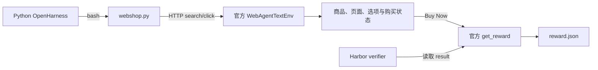

# WebShop 评测

该适配把官方 WebShop text environment 包装成 Harbor 任务。OpenHarness 不需要新增
浏览器工具：模型通过现有 `bash` 工具调用 `/workspace/webshop.py`，客户端连接同一
Docker Compose 网络中的状态化 WebShop 服务；verifier 最后读取官方 reward。

## 架构



## 准备与运行

以下命令在 Linux 或 WSL2 的 Harbor 仓库根目录执行：

```bash
export BENCHMARK_CACHE_ROOT="$HOME/.cache/harbor-rsi"
./benchmarks/scripts/fetch-webshop-source.sh
./benchmarks/scripts/build-webshop-image.sh
./benchmarks/scripts/prepare-webshop.sh

```

随后使用[原生 JobConfig 与 Campaign 四阶段](../../docs/rsi/README.md)，
任务指向生成目录，环境由 JobConfig 显式选择。正式入口只有
`harbor rsi campaign`；旧 request launcher 已删除。凭据从调用环境继承，
不隐式读取其他 benchmark 的 `.env`。WebShop 不使用 judge API。

## 正式分数边界

`small` 与 `full` 是两条独立路径：

- `small` 只使用官方 1000 商品数据，`formal_official_score = false`，仅用于接入验证。
- `full` 使用官方完整 1.18M 商品、完整 Lucene 索引和 test goal indexes `0..499`，
  `formal_official_score = true`，每项最多 100 个动作。

完整商品 JSON 约 5.48 GB。为避免在 D 盘和 Docker 镜像中重复三份大文件，full
模式把产品字段压缩到只读 SQLite，把官方检索文本建成 Lucene 索引；每个 sidecar
只读挂载同一份 D 盘资产。检索文本、页面字段、goal 顺序和 reward 仍来自固定的
Princeton WebShop 代码与数据，存储实现不改变 Agent 可见协议。

## 正式 full 准备

```bash
export BENCHMARK_CACHE_ROOT="$HOME/.cache/harbor-rsi"
./benchmarks/scripts/fetch-webshop-full-data.sh
./benchmarks/scripts/build-webshop-full-image.sh
./benchmarks/scripts/build-webshop-full-index.sh
./benchmarks/scripts/prepare-webshop-full.sh
```

生成结果：

- 原始完整数据：`sources/webshop/data/items_shuffle.json` 与 `items_ins_v2.json`
- 磁盘型正式资产：`sources/webshop-full/`
- 500 项 Harbor 数据集：`datasets/webshop/official-test-500-100-actions/`

正式运行仍经过 Prepare、Validate、Freeze、Run。冻结全部500个任务及
原官方数据身份；先用单任务测量 sidecar 和磁盘资源，再提高原生并发。
多 attempt 使用原生 `n_attempts`，不自动重试合法零分。

## 正式指标

- `Task Score = 100 × mean(reward)`
- `Success Rate = 100 × count(reward == 1) / 500`
- 同时报告平均 reward、动作数、达到 100 动作上限的任务数、覆盖率、token 与耗时。
- WebShop 直接使用官方环境 reward，不使用 LLM Judge。

## 历史样本，非本仓库验收

`webshop-smoke-latest-goal0-5` 已在 `latest@0e6e2b9d4e5b05787778116c644a46094c2a3db4`
上跑通 1 个 smoke task：

- 任务：`small-goal-0000`
- 模型：`deepseek/deepseek-flash`
- reward：`0.6666666666666666`
- `webshop_done`：`1.0`
- `webshop_steps`：`14.0`
- 记录来自迁移源 OpenHarness eval；新仓库的验证范围单独记入交付报告。

此记录是 small smoke，不是正式 full 分数。
